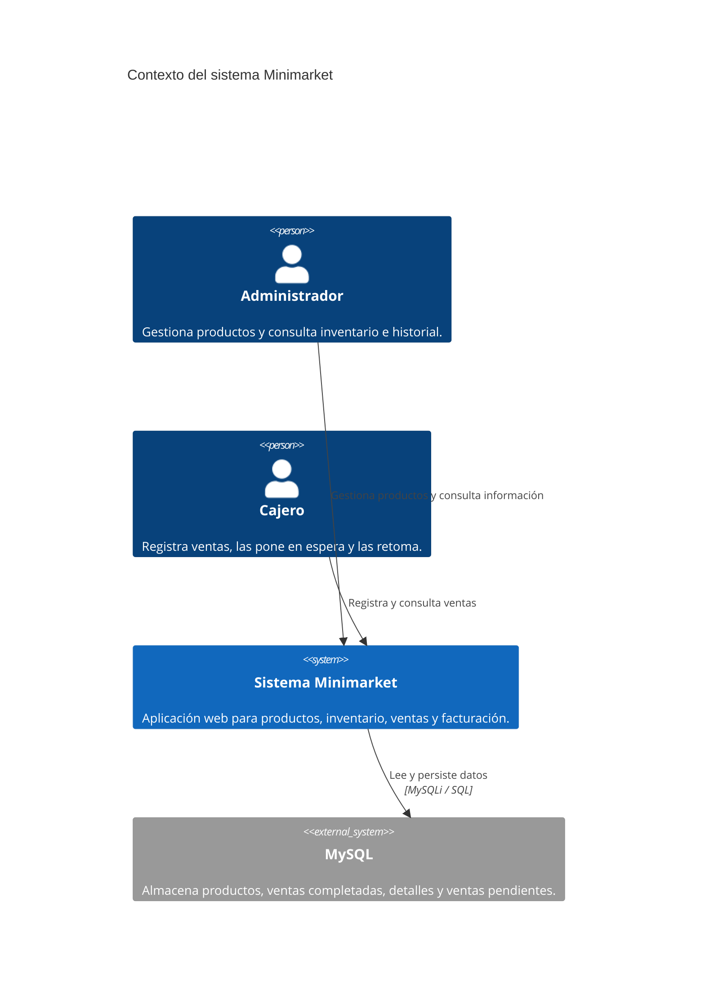
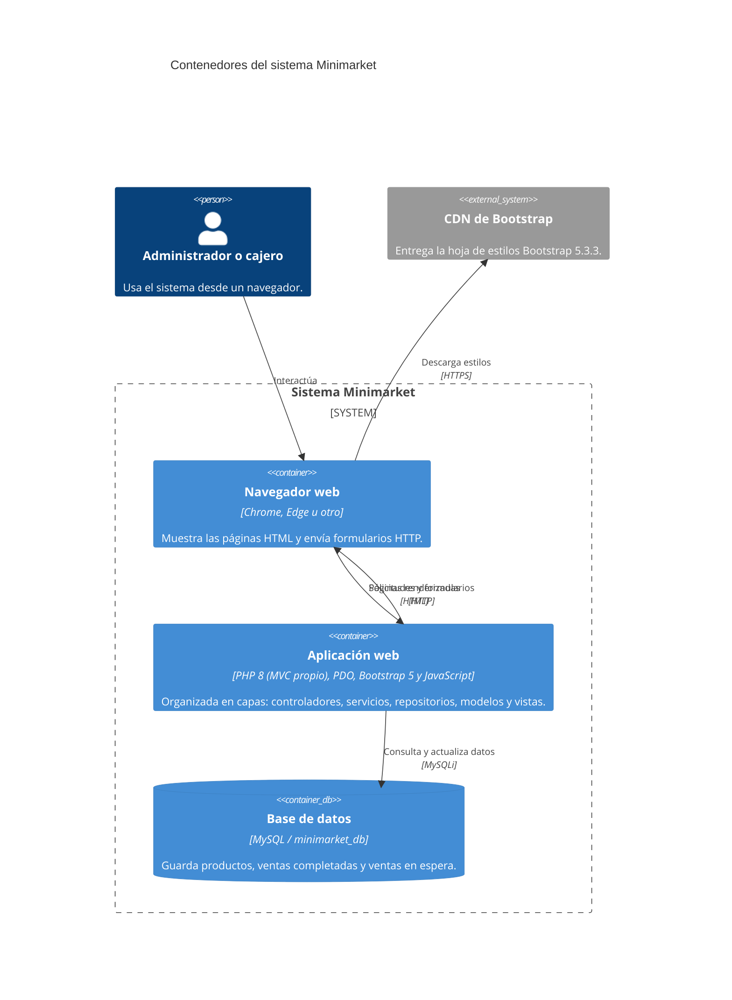
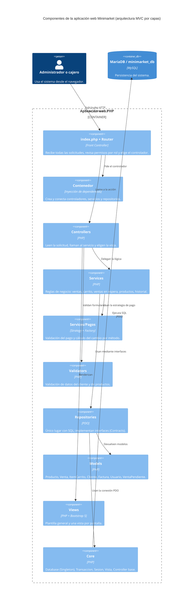
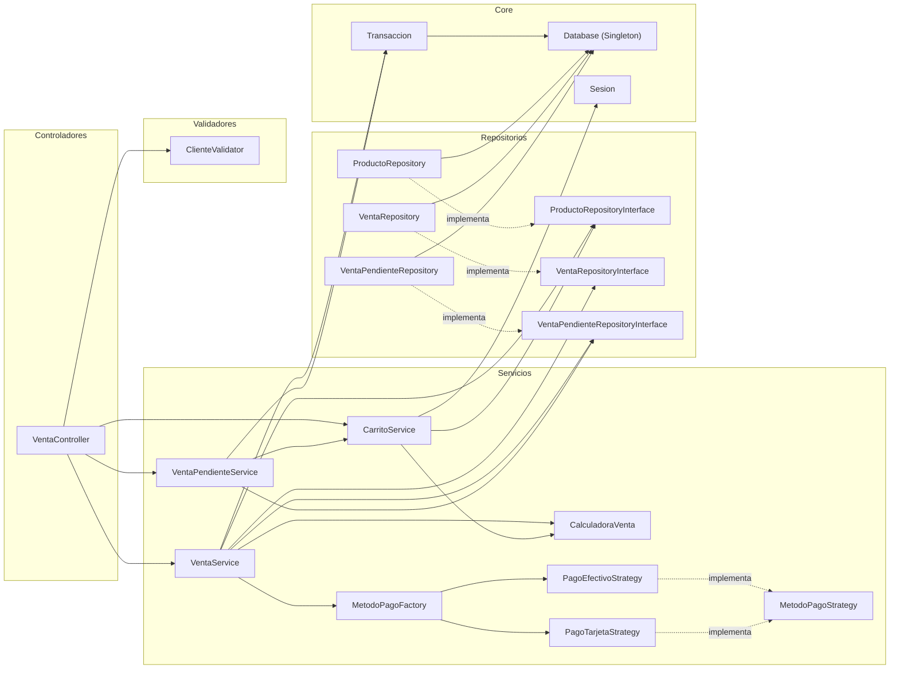
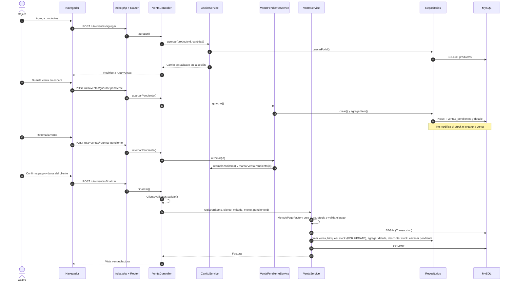

# Diagramas de arquitectura del Minimarket

Este documento presenta la arquitectura implementada en el sistema usando los
niveles de C4 y una vista adicional de secuencia. Los diagramas están escritos
en Mermaid; se pueden visualizar en editores compatibles con Mermaid, como
GitHub y extensiones de Markdown para VS Code.

## Alcance y perfiles

El sistema tiene dos perfiles seleccionables desde la pantalla de inicio:

- **Administrador:** gestiona productos y consulta inventario e historial.
- **Cajero:** registra ventas, guarda y retoma ventas pendientes, y consulta
  inventario e historial.

La selección de perfil se almacena en una sesión PHP. No se solicitan
credenciales; por eso, la selección de rol es una separación funcional y no
constituye autenticación adecuada para un despliegue público.

## 1. C4 — Diagrama de contexto

El contexto muestra quién usa el sistema y el servicio externo con el que
persiste información.

## 2. C4 — Diagrama de contenedores

La aplicación es un monolito web renderizado en el servidor. El navegador envía
formularios y recibe HTML generado por PHP; PHP consulta y actualiza MySQL.
Bootstrap se carga desde un CDN para la presentación visual.

## 3. C4 — Diagrama de componentes

La aplicación web sigue el patrón **MVC (Modelo–Vista–Controlador)** con dos
capas adicionales: **servicios** (reglas de negocio) y **repositorios**
(acceso a datos). Todas las solicitudes entran por un único archivo,
`index.php` (patrón *Front Controller*), y el `Router` decide qué controlador
las atiende.

### Responsabilidad de cada capa

| Capa | Carpeta | Responsabilidad | Ejemplo |
|---|---|---|---|
| Entrada | `minimarket/index.php`, `config/rutas.php` | Recibir la solicitud y enrutarla. | `ruta=ventas/finalizar` → `VentaController::finalizar()` |
| Controlador | `app/Controllers` | Leer el formulario, llamar al servicio y elegir la vista. No tiene SQL ni reglas de negocio. | `VentaController` |
| Servicio | `app/Services` | Reglas de negocio y coordinación de transacciones. | `VentaService::registrar()` |
| Repositorio | `app/Repositories` | Consultas SQL con PDO. Implementa una interfaz de `Contracts`. | `ProductoRepository::descontarStock()` |
| Modelo | `app/Models` | Representar los datos del negocio y sus reglas simples. | `ItemCarrito::subtotal()` |
| Vista | `app/Views` | Mostrar HTML con Bootstrap. No consulta la base de datos. | `ventas/factura.php` |
| Núcleo | `app/Core` | Piezas comunes: conexión, transacción, sesión, enrutador. | `Database::obtenerConexion()` |

### Tablas principales

| Tabla | Uso |
|---|---|
| `productos` | Catálogo, stock disponible y estado (`activo` = 1 se vende, 0 descontinuado). |
| `ventas` | Ventas cobradas, método de pago, cliente y estado. |
| `detalle_venta` | Líneas de productos incluidas en cada venta cobrada. |
| `ventas_pendientes` | Encabezado y total de una venta guardada en espera. |
| `detalle_venta_pendiente` | Productos, precios y cantidades de la venta en espera. |

Un producto con ventas registradas no se elimina, para no dejar facturas sin su
producto; en su lugar se marca como **descontinuado**: deja de aparecer en las
ventas y no se puede reponer, pero se conserva en el historial.

Las ventas en espera se almacenan separadas de las ventas cobradas. No reducen
el stock ni reservan un número de factura; al cobrarlas se crea el registro
normal en `ventas` y se elimina la versión pendiente dentro de la misma
transacción.

## 4. Vista de código y dependencias

El diagrama muestra las clases que participan en el flujo de ventas y sus
dependencias. Las flechas punteadas indican que una clase implementa una
interfaz.

### Patrones de diseño implementados

1. **MVC (Modelo–Vista–Controlador):** separa los datos (`Models`), la
   presentación (`Views`) y el manejo de solicitudes (`Controllers`).
2. **Front Controller — `index.php` + `Router`:** todas las solicitudes entran
   por un solo archivo; los permisos por rol se revisan en un único lugar
   (`config/rutas.php`).
3. **Service Layer — `app/Services`:** las reglas de negocio quedan fuera de
   los controladores y se pueden probar sin navegador.
4. **Repository — `app/Repositories`:** cada tabla tiene un repositorio que
   concentra su SQL. Los servicios dependen de las interfaces de
   `Repositories/Contracts` (principio de inversión de dependencias), por eso
   las pruebas pueden usar repositorios falsos en memoria.
5. **Singleton — `Database`:** garantiza una sola conexión PDO por solicitud.
6. **Strategy — `MetodoPagoStrategy`:** `PagoEfectivoStrategy` calcula el
   cambio; `PagoTarjetaStrategy` devuelve cero. Ambas rechazan un pago menor al
   total.
7. **Factory — `MetodoPagoFactory`:** crea la estrategia según el método
   elegido. Agregar un método nuevo solo requiere una clase y una línea en la
   fábrica.
8. **Inyección de dependencias — `Contenedor`:** cada clase recibe por su
   constructor lo que necesita; el contenedor es el único lugar donde se arman
   los objetos.

### Principios SOLID aplicados

| Principio | Dónde se ve |
|---|---|
| Responsabilidad única (S) | Cada clase tiene una sola tarea: `ClienteValidator` valida, `VentaRepository` guarda, `VentaController` coordina la pantalla. |
| Abierto/cerrado (O) | Un método de pago nuevo se agrega con una clase nueva, sin modificar `VentaService`. |
| Sustitución de Liskov (L) | Cualquier `MetodoPagoStrategy` o implementación de un repositorio se puede usar en lugar de otra. |
| Segregación de interfaces (I) | Hay una interfaz por repositorio, con solo los métodos que ese repositorio ofrece. |
| Inversión de dependencias (D) | Los servicios dependen de `Contracts/*Interface`, no de las clases con SQL. |

## 5. C4+1 — Diagrama de secuencia

Escenario principal: guardar una venta en espera, retomarla y cobrarla.

## Archivos relacionados

- Punto de entrada: [`minimarket/index.php`](./minimarket/index.php).
- Rutas y permisos: [`minimarket/config/rutas.php`](./minimarket/config/rutas.php).
- Registro de ventas: [`minimarket/app/Services/VentaService.php`](./minimarket/app/Services/VentaService.php).
- Patrones de pago: [`minimarket/app/Services/Pagos`](./minimarket/app/Services/Pagos).
- Esquema de base de datos: [`minimarket/database/database.sql`](./minimarket/database/database.sql).
- Migración de la versión 0.2: [`minimarket/database/migracion_v0_2.sql`](./minimarket/database/migracion_v0_2.sql).
- Migración de la versión 0.3 (productos descontinuados): [`minimarket/database/migracion_v0_3.sql`](./minimarket/database/migracion_v0_3.sql).
- Pruebas automáticas: [`pruebas/ejecutar_pruebas.php`](./pruebas/ejecutar_pruebas.php).
