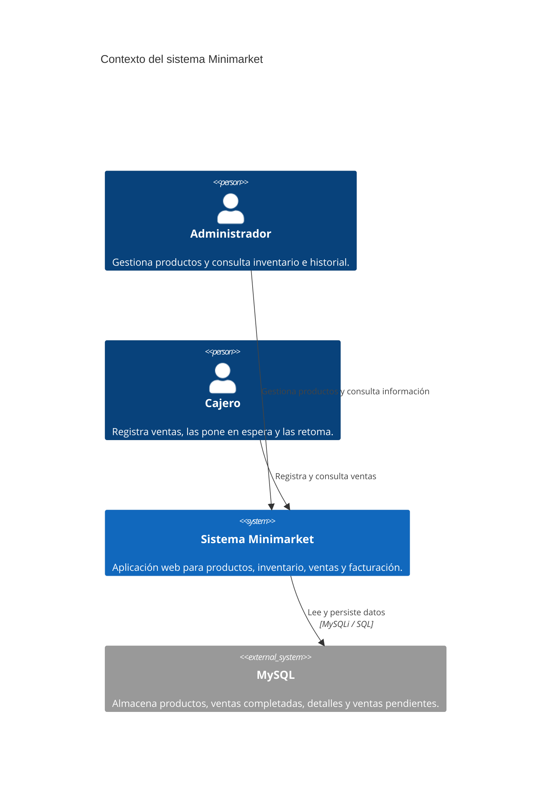
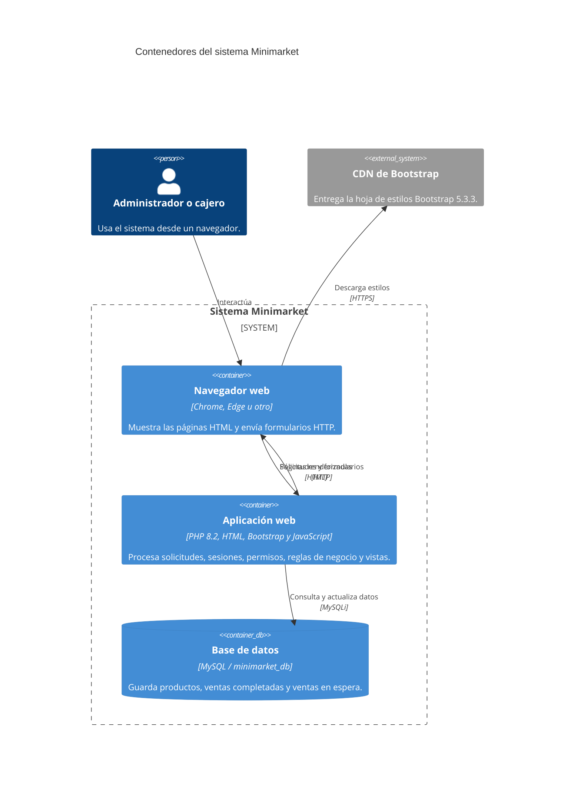
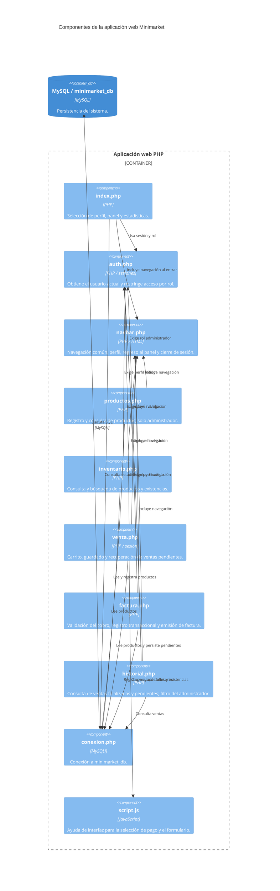
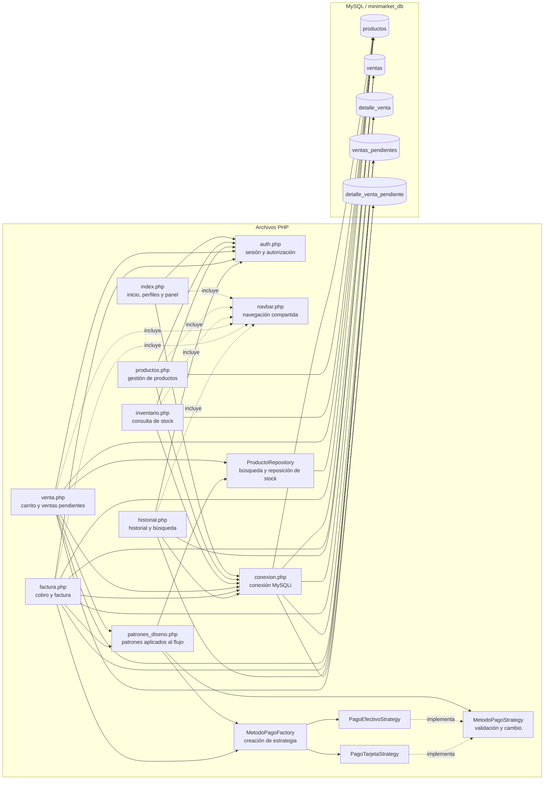
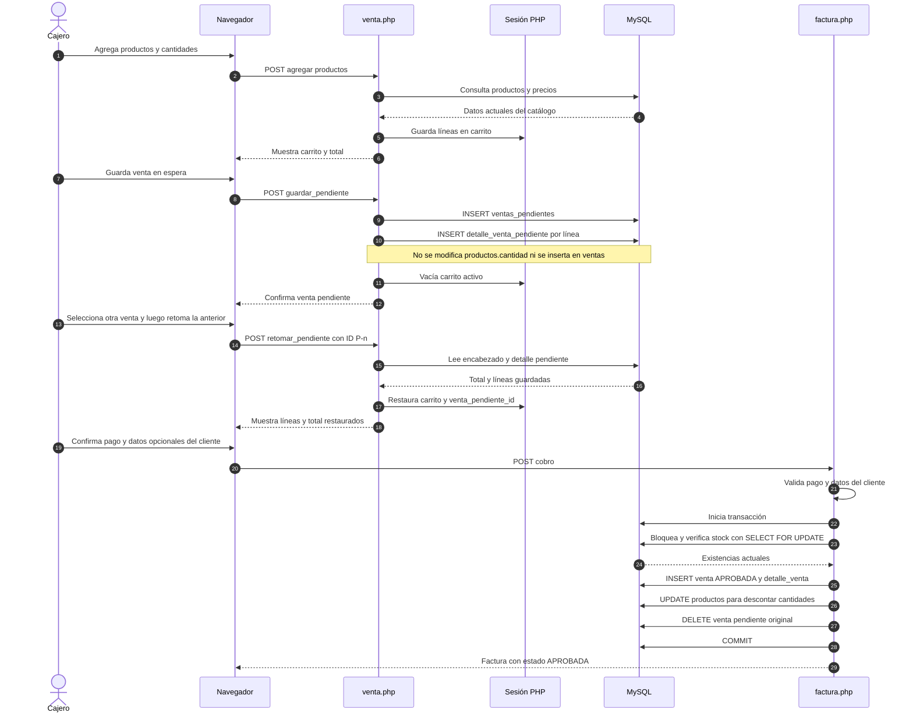

# Diagramas de arquitectura del Minimarket

Este documento presenta la arquitectura implementada en el sistema usando los
niveles de C4 y una vista adicional de secuencia. Los diagramas están escritos
en Mermaid; se pueden visualizar en editores compatibles con Mermaid, como
GitHub y extensiones de Markdown para VS Code.

## Alcance y perfiles

El sistema tiene dos perfiles seleccionables desde la pantalla de inicio:

- **Administrador:** gestiona productos y consulta inventario e historial.
- **Cajero:** registra ventas, guarda y retoma ventas pendientes, y consulta
  inventario e historial.

La selección de perfil se almacena en una sesión PHP. No se solicitan
credenciales; por eso, la selección de rol es una separación funcional y no
constituye autenticación adecuada para un despliegue público.

## 1. C4 — Diagrama de contexto

El contexto muestra quién usa el sistema y el servicio externo con el que
persiste información.

## 2. C4 — Diagrama de contenedores

La aplicación es un monolito web renderizado en el servidor. El navegador envía
formularios y recibe HTML generado por PHP; PHP consulta y actualiza MySQL.
Bootstrap se carga desde un CDN para la presentación visual.

## 3. C4 — Diagrama de componentes

Los componentes corresponden a las páginas y archivos PHP que organizan la
aplicación. `auth.php`, `navbar.php` y `conexion.php` son compartidos por las
páginas que los requieren.

### Tablas principales

| Tabla | Uso |
|---|---|
| `productos` | Catálogo y stock disponible. |
| `ventas` | Ventas cobradas, método de pago, cliente y estado. |
| `detalle_venta` | Líneas de productos incluidas en cada venta cobrada. |
| `ventas_pendientes` | Encabezado y total de una venta guardada en espera. |
| `detalle_venta_pendiente` | Productos, precios y cantidades de la venta en espera. |

Las ventas en espera se almacenan separadas de las ventas cobradas. No reducen
el stock ni reservan un número de factura; al cobrarlas se crea el registro
normal en `ventas` y se elimina la versión pendiente dentro de la misma
transacción.

## 4. Vista de código y dependencias

Las páginas siguen siendo PHP procedural, pero el flujo de ventas ahora usa
clases pequeñas para aplicar tres patrones de diseño: Repository, Strategy y
Factory. El siguiente diagrama muestra estos elementos implementados y sus
dependencias reales.

### Patrones de diseño implementados

1. **Repository — `ProductoRepository`:** concentra las consultas usadas por
   el flujo de ventas para buscar un producto por identificador y listar los
   productos disponibles. También ofrece la operación de reponer un producto
   agotado por su código, usada por la gestión de productos. `venta.php` y
   `productos.php` solicitan estas operaciones al repositorio en vez de
   construir esas consultas directamente. Esto permite separar el acceso a
   productos del procesamiento de las pantallas.
2. **Strategy — `MetodoPagoStrategy`:** define un contrato común para validar
   un pago y calcular el cambio. `PagoEfectivoStrategy` calcula el cambio en
   efectivo; `PagoTarjetaStrategy` devuelve cero. Cada estrategia rechaza un
   monto inferior al total.
3. **Factory — `MetodoPagoFactory`:** elige y construye la estrategia
   correspondiente a `"Efectivo"` o `"Tarjeta"`. `factura.php` trabaja con el
   contrato común, sin tener que decidir cómo se calcula el cambio para cada
   método.

Estas implementaciones conservan los métodos de pago, las reglas de cobro y el
flujo de inventario ya existentes. Se encuentran en
[`minimarket/patrones_diseno.php`](./minimarket/patrones_diseno.php).

## 5. C4+1 — Diagrama de secuencia

La vista dinámica siguiente documenta el escenario principal solicitado:
guardar una venta en espera, atender otra operación, recuperar la primera y
cobrarla. Los mensajes al navegador representan respuestas HTTP renderizadas;
las escrituras de finalización se agrupan en una transacción.

## Archivos relacionados

- Esquema de base de datos: [`minimarket/database.sql`](./minimarket/database.sql).
- Migración de la versión 0.2: [`minimarket/migracion_v0_2.sql`](./minimarket/migracion_v0_2.sql).
- Perfiles y sesiones: [`minimarket/auth.php`](./minimarket/auth.php).
- Ventas y ventas pendientes: [`minimarket/venta.php`](./minimarket/venta.php).
- Cobro y factura: [`minimarket/factura.php`](./minimarket/factura.php).
- Consulta del historial: [`minimarket/historial.php`](./minimarket/historial.php).
